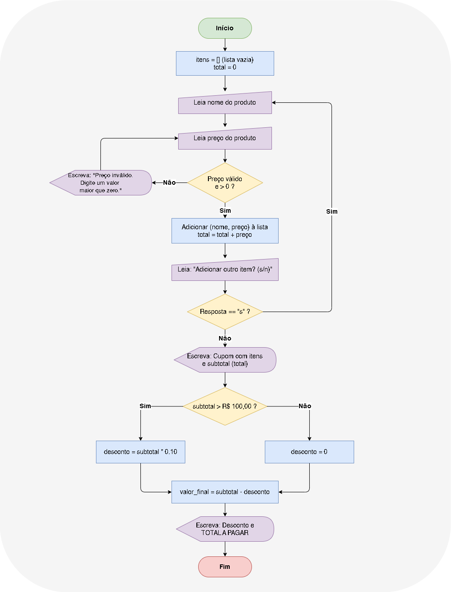

[← Voltar ao README](../README.md)

# Projeto 1: Mini PDV (Ponto de Venda)

> **Nível:** Iniciante | **Conceitos:** `while`, `if/else`, acumulador, lista, validação de entrada

### 1. O Problema

Um supermercado precisa de um programa de caixa que registre os produtos de um cliente, calcule o total da compra e aplique desconto quando a compra for grande.

### 2. Requisitos do Sistema

- **RF01:** perguntar o nome e o preço de cada produto.
- **RF02:** perguntar se o cliente deseja adicionar mais itens (repetição).
- **RF03:** rejeitar preços inválidos (texto ou valor menor ou igual a zero) e pedir novamente.
- **RF04:** ao final, exibir um cupom com a lista de itens, o subtotal, o desconto e o total a pagar.

### 3. Regras de Negócio

- **RN01:** se o subtotal for **maior que R$ 100,00**, aplicar **10% de desconto**.
- **RN02:** caso contrário, não há desconto.

### 4. Entradas e Saídas

| Entradas | Saídas |
|----------|--------|
| Nome do produto (texto) | Cupom com os itens |
| Preço (número) | Subtotal |
| Continuar? (`s`/`n`) | Desconto aplicado |
| | Total a pagar |

### 5. Fluxograma

### 6. Telas

### 7. Desafios Extras

- Pedir a **quantidade** de cada produto (subtotal do item = preço × quantidade).
- Perguntar a **forma de pagamento** e, em dinheiro, calcular o **troco**.
- Criar um **desconto progressivo** (ex.: 5% acima de R$ 50, 10% acima de R$ 100, 15% acima de R$ 200).

### 8. Critérios de Conclusão

- [ ] O programa não quebra ao digitar letras no preço.
- [ ] O cupom lista todos os itens digitados.
- [ ] Compra de R$ 100,00 **não** tem desconto; compra de R$ 100,01 tem.
- [ ] O total a pagar está correto nos dois cenários.

---

[Índice](../README.md)
