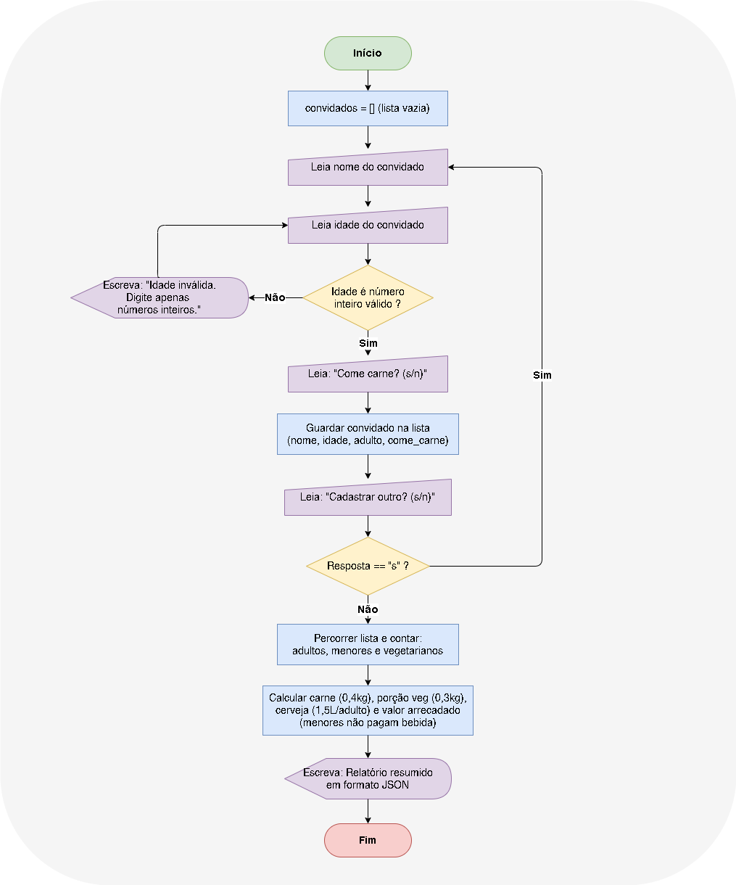

[← Voltar ao README](../README.md)

# Projeto 2: Contador de Churrasco

> **Nível:** Iniciante | **Conceitos:** `while`, contadores, lista de dicionários, JSON

### 1. O Problema

Um organizador de churrasco quer cadastrar os convidados e descobrir **quanta comida comprar**, **quanta bebida comprar** e **quanto cada pessoa deve pagar**.

### 2. Requisitos do Sistema

- **RF01:** cadastrar convidados (nome, idade e se come carne), um por vez, em repetição.
- **RF02:** validar a idade (somente números inteiros).
- **RF03:** guardar cada convidado como um dicionário dentro de uma lista.
- **RF04:** ao final, gerar um relatório resumido em formato **JSON**.

### 3. Regras de Negócio

- **RN01:** menores de 18 anos **não pagam** a cota de bebida alcoólica (pagam só a comida).
- **RN02:** vegetarianos (quem não come carne) entram na conta de comida com porção vegetariana.
- **RN03:** adultos pagam cota de comida **e** de bebida.
- **RN04:** porções de referência (ajustáveis nas constantes): carne 0,4 kg por pessoa, porção vegetariana 0,3 kg por pessoa, cerveja 1,5 L por adulto.

### 4. Entradas e Saídas

| Entradas | Saídas |
|----------|--------|
| Nome do convidado | Total de convidados, adultos e menores |
| Idade | Total de vegetarianos |
| Come carne? (`s`/`n`) | Kg de carne e de porção vegetariana |
| Cadastrar outro? (`s`/`n`) | Litros de cerveja |
| | Valor arrecadado (JSON) |

### 5. Fluxograma

### 6. Desafios Extras

- Exibir **quanto cada convidado paga** (nome e valor).
- Adicionar uma pergunta "Bebe álcool?" para adultos que não bebem pagarem só a comida.
- **Salvar o relatório** em um arquivo `.json` com `open()` e `json.dump()`.

### 7. Critérios de Conclusão

- [ ] Idade com letras ou vazia é rejeitada.
- [ ] Menor de 18 anos **não** entra na conta da cerveja nem paga a cota de bebida.
- [ ] Idade 18 conta como adulto; 17 conta como menor.
- [ ] O JSON final tem todos os campos e valores coerentes com os cadastros.

---

 [Índice](../README.md)
