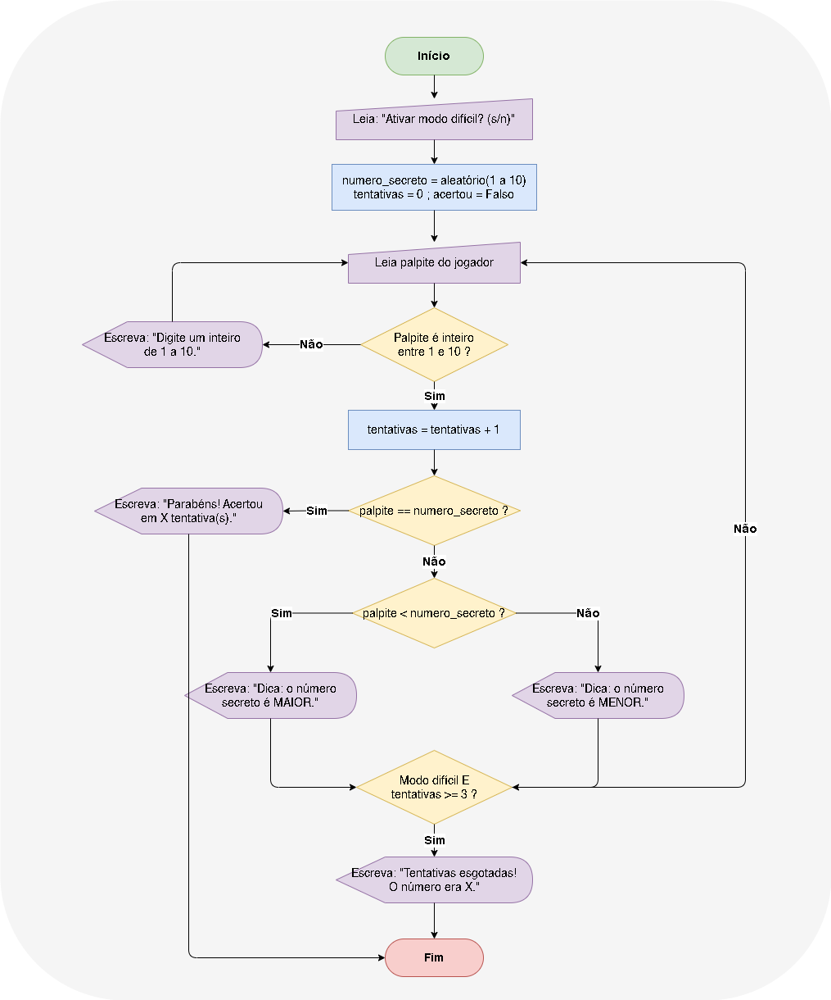

[← Voltar ao README](../README.md)

# Projeto 3: Jogo de Adivinhação

> **Nível:** Iniciante | **Conceitos:** `random`, `while`, comparação, contador

### 1. O Problema

Criar um jogo em que o computador "pensa" em um número secreto e o jogador tenta descobri-lo com dicas de maior ou menor.

### 2. Requisitos do Sistema

- **RF01:** sortear um número inteiro de 1 a 10.
- **RF02:** pedir palpites ao jogador em repetição até ele acertar.
- **RF03:** após cada palpite errado, dizer se o número secreto é **maior** ou **menor**.
- **RF04:** contar e exibir o número de tentativas ao final.
- **RF05 (modo difícil):** permitir ativar um limite de 3 tentativas.

### 3. Regras de Negócio

- **RN01:** palpites inválidos (texto ou fora do intervalo 1 a 10) **não consomem** tentativa.
- **RN02:** no modo difícil, o jogador perde ao esgotar as 3 tentativas sem acertar.
- **RN03:** ao perder, o programa revela o número secreto.

### 4. Entradas e Saídas

| Entradas | Saídas |
|----------|--------|
| Modo difícil? (`s`/`n`) | Dicas "maior" ou "menor" |
| Palpites (inteiros de 1 a 10) | Mensagem de vitória ou derrota |
| | Número de tentativas |

### 5. Fluxograma

### 6. Desafios Extras

- Perguntar "Jogar novamente? (s/n)" e repetir a partida.
- Deixar o jogador escolher o **intervalo** (ex.: 1 a 100) e calcular um limite justo de tentativas.
- Guardar o **recorde** (menor número de tentativas) durante a sessão.

### 7. Critérios de Conclusão

- [ ] Digitar "abc" ou 11 não gasta tentativa.
- [ ] As dicas de maior e menor estão corretas.
- [ ] No modo difícil, o jogo termina na 3ª tentativa errada.
- [ ] O contador de tentativas exibido está correto.

---

 [Índice](../README.md) 
