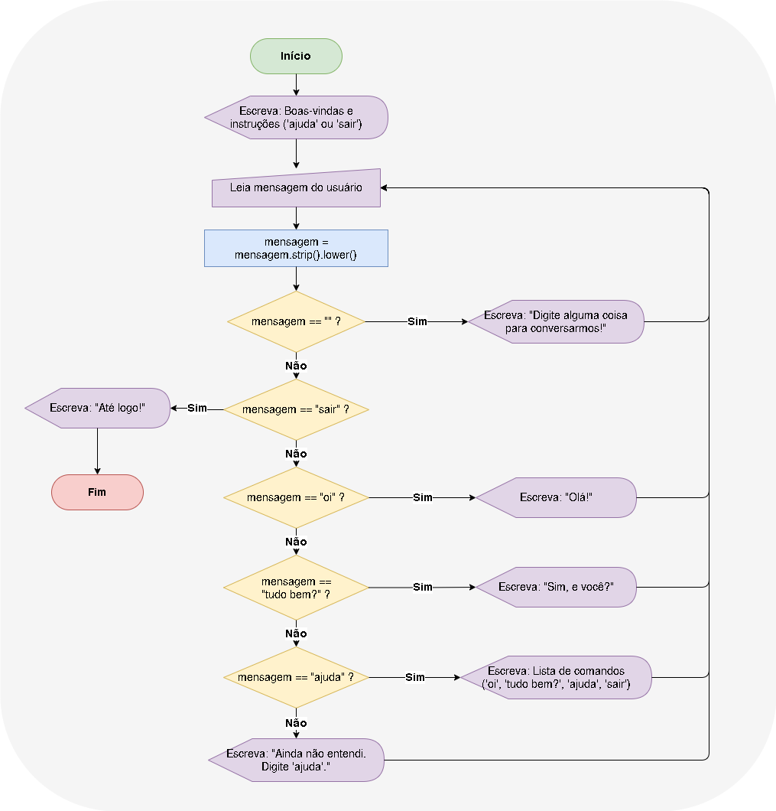

[← Voltar ao README](../README.md)

# Projeto 4: Chatbot Simples

> **Nível:** Iniciante | **Conceitos:** `if/elif/else`, strings, `while True`, `break`

### 1. O Problema

Criar um assistente de conversa por texto que reconhece algumas frases e responde de acordo, até o usuário encerrar a conversa.

### 2. Requisitos do Sistema

- **RF01:** conversar em repetição até o usuário digitar `sair`.
- **RF02:** responder `"oi"` com `"Olá!"`.
- **RF03:** responder `"tudo bem?"` com `"Sim, e você?"`.
- **RF04:** responder qualquer outra frase com uma resposta padrão.
- **RF05:** oferecer o comando `ajuda`, que lista o que o bot entende.

### 3. Regras de Negócio

- **RN01:** a comparação ignora maiúsculas, minúsculas e espaços nas pontas (`" OI "` vale como `"oi"`).
- **RN02:** mensagem vazia recebe um pedido para digitar algo.

### 4. Entradas e Saídas

| Entradas | Saídas |
|----------|--------|
| Mensagens de texto | Respostas do bot |
| Comandos `ajuda` e `sair` | Lista de comandos / despedida |

### 5. Fluxograma

### 6. Desafios Extras

- Criar um **menu de comandos numerado** (1 = piada, 2 = hora, 3 = sair).
- Dar uma **personalidade** ao bot (bem-humorado, formal, pirata...).
- Guardar as respostas em um **dicionário** (`respostas = {"oi": "Olá!"}`) e eliminar a cadeia de `elif`.
- Perguntar o **nome do usuário** no início e usá-lo nas respostas.

### 7. Critérios de Conclusão

- [ ] `OI`, `  oi  ` e `Oi` são reconhecidos.
- [ ] Frases desconhecidas recebem a resposta padrão.
- [ ] `sair` encerra o programa com despedida.
- [ ] `ajuda` lista todos os comandos que o bot realmente entende.

---

 [Índice](../README.md)
