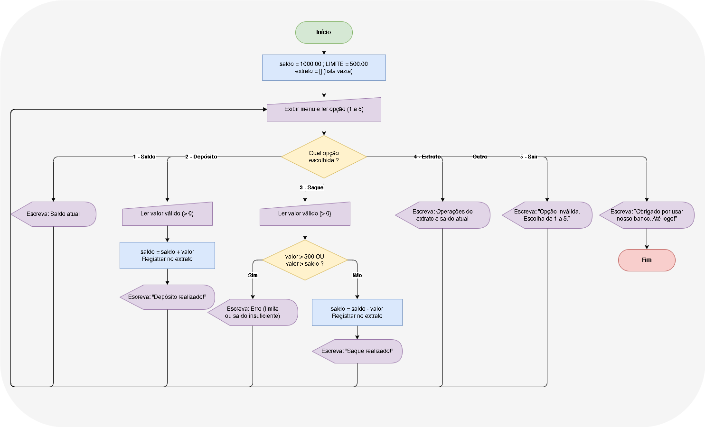

[← Voltar ao README](../README.md)

# Projeto 5: Caixa Eletrônico (ATM)

> **Nível:** Intermediário | **Conceitos:** menu, funções, saldo, extrato (lista), validação

### 1. O Problema

Um banco precisa de um terminal simples onde o cliente consulta saldo, deposita, saca e vê o extrato das operações da sessão.

### 2. Requisitos do Sistema

- **RF01:** exibir um menu com as opções: saldo, depósito, saque, extrato e sair.
- **RF02:** repetir o menu até o usuário escolher sair.
- **RF03:** validar valores digitados (número maior que zero).
- **RF04:** registrar cada depósito e saque em um extrato.

### 3. Regras de Negócio

- **RN01:** o saldo inicial é R$ 1.000,00.
- **RN02:** não é possível sacar mais do que o saldo disponível.
- **RN03:** o limite por saque é de R$ 500,00.
- **RN04:** depósitos e saques aceitam apenas valores positivos.

### 4. Entradas e Saídas

| Entradas | Saídas |
|----------|--------|
| Opção do menu (1 a 5) | Saldo atual |
| Valor de depósito ou saque | Confirmações e mensagens de erro |
| | Extrato das operações |

### 5. Fluxograma

### 6. Telas

### 7. Desafios Extras

- Adicionar **PIN de 4 dígitos** com no máximo 3 tentativas.
- Limitar a **3 saques por sessão**.
- Criar uma **taxa de saque** (ex.: R$ 2,50 por operação).
- Transformar cada opção em uma **função** (`depositar()`, `sacar()`...).

### 8. Critérios de Conclusão

- [ ] Saque maior que o saldo ou maior que R$ 500,00 é recusado.
- [ ] Valores negativos, zero e texto são recusados.
- [ ] O extrato lista todas as operações na ordem em que ocorreram.
- [ ] O saldo final bate com as operações do extrato.

---

[← Chatbot Simples](04-chatbot-simples.md) | [Índice](../README.md) | [Lista de Tarefas →](06-lista-de-tarefas.md)
