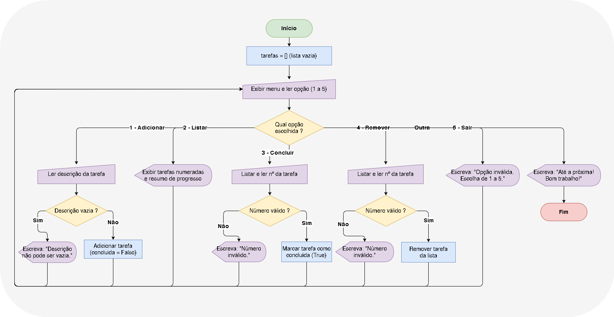

[← Voltar ao README](../README.md)

# Projeto 6: Lista de Tarefas

> **Nível:** Intermediário | **Conceitos:** lista de dicionários, CRUD (criar, listar, atualizar, remover), índices

### 1. O Problema

Uma pessoa quer organizar seu dia com um programa que guarda tarefas, mostra o que está pendente e o que já foi feito.

### 2. Requisitos do Sistema

- **RF01:** adicionar tarefa (descrição).
- **RF02:** listar tarefas numeradas, indicando se estão concluídas.
- **RF03:** marcar uma tarefa como concluída pelo número.
- **RF04:** remover uma tarefa pelo número.
- **RF05:** repetir o menu até o usuário sair.

### 3. Regras de Negócio

- **RN01:** não aceitar tarefa com descrição vazia.
- **RN02:** números de tarefa devem existir na lista (de 1 até o total).
- **RN03:** toda tarefa nova começa como **pendente**.
- **RN04:** ao listar, exibir o resumo "X concluída(s) de Y".

### 4. Entradas e Saídas

| Entradas | Saídas |
|----------|--------|
| Opção do menu | Lista numerada com `[ ]` ou `[x]` |
| Descrição da tarefa | Resumo de progresso |
| Número da tarefa | Mensagens de confirmação ou erro |

### 5. Fluxograma

### 6. Telas

### 7. Desafios Extras

- Adicionar **prioridade** (alta, média, baixa) e listar por prioridade.
- Permitir **editar** a descrição de uma tarefa.
- **Salvar e carregar** as tarefas de um arquivo `.json` ao abrir e fechar o programa.

### 8. Critérios de Conclusão

- [ ] Tarefa vazia, número 0 e número acima do total são recusados.
- [ ] Após remover uma tarefa, a numeração se ajusta corretamente.
- [ ] O resumo "X concluída(s) de Y" está correto.
- [ ] Listar com a lista vazia não gera erro.

---

[← Caixa Eletrônico (ATM)](05-caixa-eletronico-atm.md) | [Índice](../README.md) | [Boletim Escolar →](07-boletim-escolar.md)
