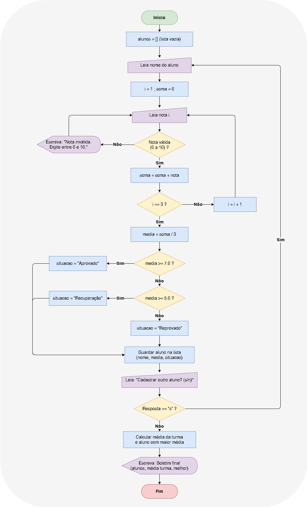

[← Voltar ao README](../README.md)

# Projeto 7: Boletim Escolar

> **Nível:** Intermediário | **Conceitos:** `for`, dicionários, média, classificação por faixas

### 1. O Problema

Um professor quer registrar as notas dos alunos, calcular a média de cada um e saber quem foi aprovado, quem ficou em recuperação e quem foi reprovado.

### 2. Requisitos do Sistema

- **RF01:** cadastrar alunos em repetição (nome e 3 notas).
- **RF02:** validar cada nota (número entre 0 e 10).
- **RF03:** calcular a média de cada aluno.
- **RF04:** classificar a situação de cada aluno.
- **RF05:** exibir um boletim final com a média da turma e o aluno com a maior média.

### 3. Regras de Negócio

- **RN01:** média **maior ou igual a 7,0**: **Aprovado**.
- **RN02:** média **maior ou igual a 5,0 e menor que 7,0**: **Recuperação**.
- **RN03:** média **menor que 5,0**: **Reprovado**.
- **RN04:** a média é aritmética simples das 3 notas.

### 4. Entradas e Saídas

| Entradas | Saídas |
|----------|--------|
| Nome do aluno | Boletim por aluno (média e situação) |
| 3 notas (0 a 10) | Média da turma |
| Cadastrar outro? (`s`/`n`) | Aluno com a maior média |

### 5. Fluxograma

### 6. Telas

### 7. Desafios Extras

- Contar quantos alunos ficaram em **cada situação** (aprovados, recuperação, reprovados).
- Permitir **pesos diferentes** para as notas (ex.: prova final vale mais).
- Exibir os alunos **ordenados por média** (`sorted` com `key`).

### 8. Critérios de Conclusão

- [ ] Notas como -1, 11 e texto são recusadas.
- [ ] Média exatamente 7,0 resulta em Aprovado; exatamente 5,0 em Recuperação.
- [ ] A média da turma e o melhor aluno estão corretos.
- [ ] O programa funciona com apenas 1 aluno cadastrado.

---

[Índice](../README.md)
