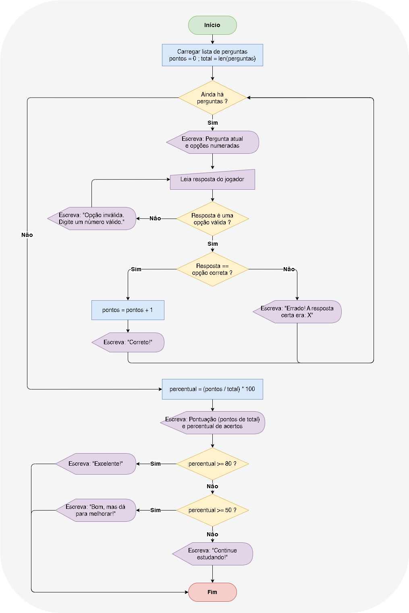

[← Voltar ao README](../README.md)

# Projeto 8: Quiz de Perguntas

> **Nível:** Intermediário | **Conceitos:** lista de dicionários, `for`, pontuação, percentual

### 1. O Problema

Criar um quiz de conhecimentos gerais em que o jogador responde perguntas de múltipla escolha e recebe uma pontuação e um feedback no final.

### 2. Requisitos do Sistema

- **RF01:** armazenar as perguntas em uma lista de dicionários (pergunta, opções e resposta correta).
- **RF02:** exibir cada pergunta com opções numeradas e ler a resposta do jogador.
- **RF03:** validar a resposta (somente números das opções existentes).
- **RF04:** indicar se o jogador acertou ou errou, mostrando a resposta correta nos erros.
- **RF05:** exibir pontuação final, percentual de acertos e uma mensagem de desempenho.

### 3. Regras de Negócio

- **RN01:** cada acerto vale **1 ponto**.
- **RN02:** resposta inválida não conta como erro: a pergunta é repetida.
- **RN03:** desempenho: **80% ou mais**: "Excelente!"; **50% a 79%**: "Bom, mas dá para melhorar!"; **abaixo de 50%**: "Continue estudando!".

### 4. Entradas e Saídas

| Entradas | Saídas |
|----------|--------|
| Número da opção escolhida | Feedback de acerto ou erro por pergunta |
| | Pontuação final (X de Y) |
| | Percentual e mensagem de desempenho |

### 5. Fluxograma

### 6. Desafios Extras

- **Embaralhar** a ordem das perguntas com `random.shuffle()`.
- Perguntar "Jogar novamente?" e guardar a **melhor pontuação**.
- Organizar as perguntas por **categoria** e deixar o jogador escolher o tema.
- Adicionar **tempo limite** por pergunta (módulo `time`).

### 7. Critérios de Conclusão

- [ ] Opção 0, 5 (quando só há 4 opções) e texto são recusadas sem perder a pergunta.
- [ ] A pontuação final corresponde ao número de acertos reais.
- [ ] Adicionar uma nova pergunta à lista funciona sem alterar o resto do código.
- [ ] A mensagem de desempenho muda corretamente nas três faixas.

---

 [Índice](../README.md)
