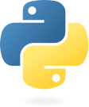

# Projetos Python: Lógica de Programação na Prática

Coleção de **8 projetos progressivos** para aprender lógica de programação com Python. Cada projeto parte de um problema do dia a dia (caixa de supermercado, churrasco, banco, notas da escola) descrevendo o problema, apresentando os requisitos e as regras de negócio, necessárias para implementação do código Python.

## Para quem é

Estudantes iniciantes em Python.

## Organização

- O projeto será desenvolvido em grupos com 4 pessoas
- Serão dois dias para construir a solução e o terceiro para apresentar para a turma
- Cada grupo terá 10 minutos para apresentar a sua solução

## Trilha de projetos

Cada grupo deverá escolher um dos 8 projetos abaixo para  desenvolver

| | # | Projeto | Nível | Conceitos principais |
|---|---|---------|-------|----------------------|
|  | 1 | [Mini PDV (Ponto de Venda)](01_mini_pdv/README.md) | Iniciante | `while`, `if/else`, acumulador, validação de entrada |
|  | 2 | [Contador de Churrasco](02_calculadora_churrasco/README.md) | Iniciante | `while`, contadores, lista de dicionários, JSON |
|  | 3 | [Jogo de Adivinhação](03_jogo_adivinhacao/README.md) | Iniciante | `random`, `while`, comparação, contador |
|  | 4 | [Chatbot Simples](04_chatbot_simples/README.md) | Iniciante | `if/elif`, strings, `while True`, `break` |
|  | 5 | [Caixa Eletrônico (ATM)](projetos/05-caixa-eletronico-atm.md) | Intermediário | menu, funções, saldo, extrato (lista) |
|  | 6 | [Lista de Tarefas](01_mini_pdv/README.md) | Intermediário | lista de dicionários, CRUD, índices |
|  | 7 | [Boletim Escolar](01_mini_pdv/README.md) | Intermediário | `for`, dicionários, média, classificação |
|  | 8 | [Quiz de Perguntas](01_mini_pdv/README.md) | Intermediário | lista de dicionários, `for`, pontuação, percentual |

## Como cada projeto é organizado

Todos os arquivos seguem o mesmo padrão:

1. **O Problema:** o contexto, em linguagem simples.
2. **Requisitos do Sistema (RF):** o que o programa deve fazer.
3. **Regras de Negócio (RN):** as regras que definem os cálculos e decisões.
4. **Entradas e Saídas:** o que entra e o que sai do programa.
5. **Fluxograma:** a lógica desenhada em Mermaid.
6. **Código Base:** uma solução simples e comentada.
7. **Desafios Extras:** evoluções para quem terminar antes.
8. **Critérios de Conclusão:** checklist para validar o resultado.

## Como usar a documentação

- Leia o documento de requisitos para compreender o problema, os requisitos e as regras de negócio.
- Analise o fluxograma e implemente a solução em Python, utilizando o mínimo possível de auxílio da IA. 
- Use o checklist no final para testar sua solução.
- Se desafiem a implementar os desafios de projeto propostos

## Apresentação

- A apresentação terá o tempo máximo de 10 minutos
- Todos os integrantes do grupo deverão apresentar o projeto
- O grupo deverá criar uma apresentação de slides
- O grupo pode utilizar o **Guia de Apresentações** como referência para organizar os slides
